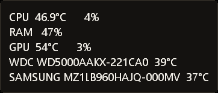
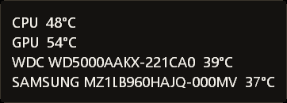
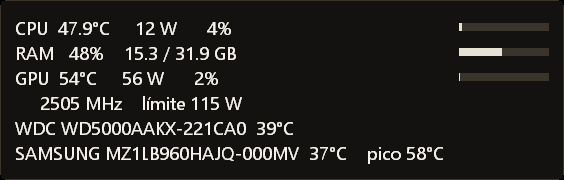
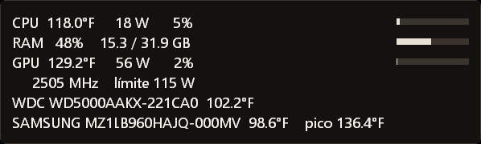
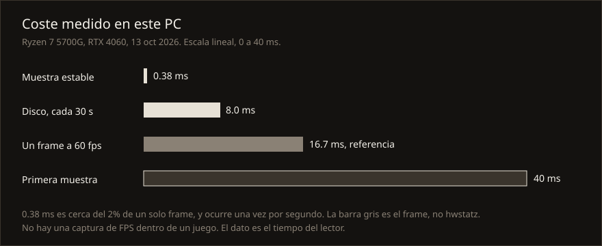
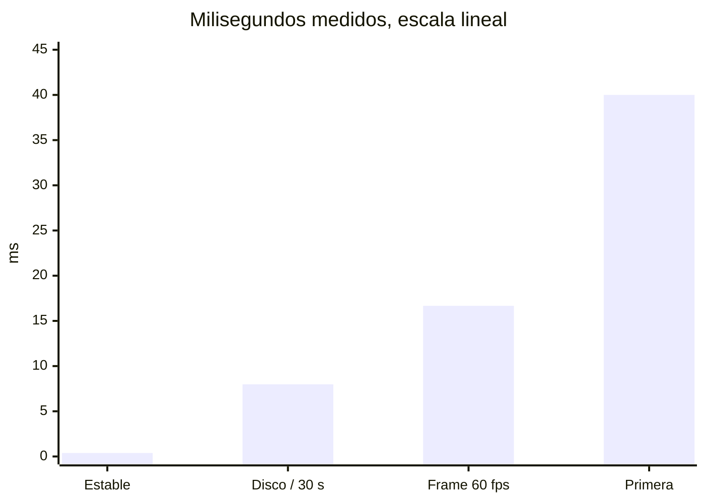
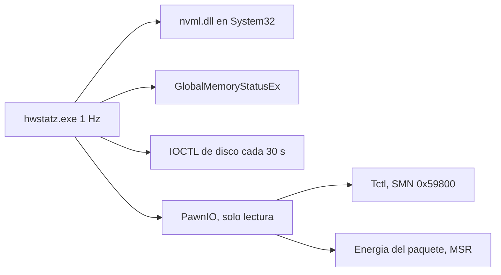

# hwstatz

hwstatz is a 1 Hz, click-through Windows overlay for CPU, GPU, RAM, and disk temperature. It does not hook the game. On the machine it was measured on, a steady sensor sample took 0.19–0.38 ms: about 2% of a single 60 fps frame, once per second.

Un panel fijo en la esquina que enseña la temperatura real. Una sola ventana nativa, sin consola, sin inyectarse en el juego y sin dejar un monitor pesado encendido. Celsius por defecto. Fahrenheit es solo la forma de mostrarlo.

Las capturas son de este PC el 13 oct 2026, en reposo. No son una especificación.

| 1 Default | 2 Simple | 3 Detallado |
| --- | --- | --- |
|  |  |  |

Fahrenheit, misma vista detallada:



## En un minuto

1. Instala [PawnIO 2.2.0 oficial](https://github.com/namazso/PawnIO.Setup/releases). El instalador verificado para este proyecto pesa 3 410 960 bytes y su SHA-256 es `1F519A22E47187F70A1379A48CA604981C4FCF694F4E65B734AAA74A9FBA3032`. No uses `-unrestricted`.
2. Descarga `AMDFamily17.bin` del release 0.2.11 de [PawnIO.Modules](https://github.com/namazso/PawnIO.Modules/releases). Tiene que pesar 10 652 bytes y su SHA-256 tiene que ser `DAE74615761B78BDF064DFB3E136252DDCC6FC727D88F14738D0E5800D427A91`. Colócalo junto a `hwstatz.exe`. No va en este repo.
3. Compila con MinGW-w64 (`gcc` y `windres` en `PATH`): `.\build.ps1`
4. Ejecuta `hwstatz.exe`. Windows pide administrador una vez, porque el dispositivo de PawnIO solo se abre elevado.
5. El icono de la bandeja abre el control. Clic izquierdo oculta o muestra. Clic derecho elige la vista, la unidad, la pantalla y la esquina.

Si el icono no aparece al lado del reloj, mira el chevron de iconos ocultos. Un proceso elevado a veces no recibe el clic de la bandeja. En ese caso ciérralo desde el Administrador de tareas.

## Vistas

La medición interna sigue en Celsius. Fahrenheit aplica `F = C × 9/5 + 32` solo al dibujar.

| Vista | Qué enseña |
| --- | --- |
| 1 Default | Temperatura y uso de CPU y GPU. RAM en porcentaje. Temperatura de los discos. Sin vatios. |
| 2 Simple | Solo temperaturas, en enteros. `CPU 48°C`, `GPU 54°C`, y los discos. |
| 3 Detallado | Temperatura, barra de uso, vatios, reloj y límite de la GPU, RAM usada/total, y el pico del disco si hay un sensor más caliente. |

La esquina y la pantalla se guardan en `hwstatz.ini`, al lado del exe. El margen es el área de trabajo del monitor, así que el panel queda encima de la barra de tareas. Una segunda ejecución despierta la que ya está y se cierra. Si la ventana no responde, el nuevo arranque cierra ese proceso. Si quedó el panel anterior, el de clase `hwstat_overlay`, también lo cierra. Un programa distinto que se llame `hwstat.exe` no se toca.

## Cuánto consume

Medido en este PC: Ryzen 7 5700G, RTX 4060, 32 GB, Windows 11 build 26300. Prioridad por debajo de lo normal. Una muestra por segundo, y solo mientras el panel está visible.



| Qué | Tiempo | Cómo leerlo |
| --- | --- | --- |
| Muestra estable (MSR, SMN, NVML) | 0.19–0.38 ms | Una vez por segundo. 0.38 ms es ~2% de un frame de 16.7 ms. |
| Refresco de discos | 8.0 ms | Cada 30 s. SMART puede tardar más en un disco que se despierta. |
| Primera muestra | ~40 ms | Una vez: carga de NVML y la primera pasada de discos. |
| CPU del proceso ya con el panel | 15.6 ms en 5 s | Un cuanto del planificador. No pidió otro. |
| Working set / privado | 31.7 MB / 27.3 MB | Incluye `nvml.dll`, que se carga una vez desde System32. |
| `hwstatz.exe` | 47 616 bytes | Sin runtime de .NET y sin consola. |

Los vatios que ves en la vista detallada son del paquete de la CPU y de la GPU. No son el consumo de hwstatz.



No medí los FPS dentro de un juego. El número de arriba es el tiempo del lector, fuera del proceso del juego. El panel es click-through: el clic atraviesa hacia lo que haya debajo. En pantalla completa exclusiva el juego tapa cualquier ventana; en ventana sin bordes el panel sigue visible.

## Qué usa



| Dato | De dónde sale | ¿Hace falta PawnIO? |
| --- | --- | --- |
| Carga de CPU | `GetSystemTimes` | No |
| Temperatura de CPU | Tctl del SMU, SMN `0x59800`, por `ioctl_read_smn` | Sí, en este 5700G |
| Vatios del paquete | MSR `0xC0010299` y `0xC001029B`, media de un segundo | Sí |
| GPU | `nvml.dll` cargada solo desde System32 | No |
| RAM | `GlobalMemoryStatusEx` | No |
| Discos | IOCTL de temperatura o SMART 194 | No, pero el handle pide administrador |

El programa rechaza cualquier nombre de ioctl que no sea `ioctl_read_msr` o `ioctl_read_smn`. Esas dos cadenas de escritura no están en el fuente ni en el exe compilado aquí.

PawnIO no arranca solo después de reiniciar: el servicio queda en Manual. Si la CPU sale como `n/d`, inícialo con `sc start PawnIO`. hwstatz no cambia el tipo de arranque.

## Frente a lo que ya existe

No medí la RAM ni la CPU de los otros programas en esta máquina. La tabla compara arquitectura y alcance, no un benchmark inventado.

| Programa | Qué es | Driver | ¿Hook al juego? | CPU de este 5700G | Para dejarlo siempre |
| --- | --- | --- | --- | --- | --- |
| hwstatz | Un overlay nativo a 1 Hz | PawnIO oficial. Este programa solo lee | No | Tctl y vatios de paquete | Sí: es el producto |
| HWiNFO | Suite de sensores, registro y alertas | Driver propio | La ventana no. El OSD dentro del juego suele apoyarse en RTSS | Cobertura amplia | Puede, con mucha más superficie |
| LibreHardwareMonitor | App .NET, a veces con servidor web | PawnIO, después de dejar WinRing0 | No | Cobertura amplia, incluidos ventiladores en muchas placas | La interfaz es más grande que un HUD |
| FanControl | Curvas de ventilador | PawnIO y la biblioteca de sensores de LHM | No | Lee sensores para mover fans | Sí, porque controla ventiladores |
| Afterburner + RTSS | Relojes, OSD y overclock | Driver de Afterburner. RTSS inyecta el OSD | RTSS sí | No es su trabajo | Sí, si quieres el OSD dentro del juego |
| NVIDIA App | Overlay, grabación y métricas de NVIDIA | Stack de NVIDIA | Overlay propio | No lee el Tctl de Ryzen | Puede |
| Administrador de tareas | Ventana del sistema | Ninguno para el diodo de esta CPU | No | En este PC muestra la GPU, no el Tctl ni los vatios de paquete | No es un HUD de esquina |

HWiNFO, LibreHardwareMonitor y FanControl responden a otra pregunta: verlo todo, registrar, o mover ventiladores. hwstatz responde a una más chica: dejar la temperatura a la vista, una vez por segundo, sin tocar el juego. El precio de esa cobertura mínima en este Ryzen es el driver firmado de PawnIO. Windows, por sí solo, no publica aquí el diodo del 5700G.

WinRing0 no se usa. Está en la lista de drivers vulnerables de Microsoft (CVE-2020-14979). PawnIO 2.2.0 firmado es el reemplazo al que pasaron FanControl, LibreHardwareMonitor y OpenRGB. La firma de atestación no es una auditoría HLK del contenido, y las comprobaciones de este repo no son una auditoría del kernel.

## Compilar

Hace falta MinGW-w64, con `gcc` y `windres` en `PATH`. Desde la raíz del repo:

```powershell
.\build.ps1
```

El manifiesto pide administrador y DPI por monitor. El enlazado es `-mwindows`, con `shell32`, `user32` y `gdi32`. No enlaza `pdh`.

`AMDFamily17.bin`, `hwstatz.exe` y `hwstatz.ini` están en `.gitignore`. El binario del módulo se descarga del release oficial y se comprueba con el hash de arriba. PawnIO y el módulo tienen sus propias licencias; no van incluidos aquí. El código de hwstatz es MIT.

## Límites

- No lee ventiladores, VRM ni chipset. El módulo no habla con el Super I/O de esta B450.
- No promete el reloj boost de la CPU. El reloj que se muestra es el de la GPU, y solo en la vista detallada.
- La pantalla completa exclusiva tapa el panel.
- Otros procesos de administrador pueden llamar las escrituras que el módulo firmado permite mientras el driver está cargado. hwstatz no las llama.
- No hay una prueba de arranque de Easy Anti-Cheat ni de Ricochet en esta sesión. No apareció una entrada pública de PawnIO en las listas de Epic o Activision que se revisaron el 13 oct 2026. La política de un anti-cheat puede cambiar. FACEIT pide la versión reciente de PawnIO; un rechazo de ese tipo impide iniciar el cliente hasta descargar el driver, que no es lo mismo que un baneo silencioso.
- Después de reiniciar, el servicio PawnIO no se levanta solo.

## Licencia

MIT. Ver [LICENSE](LICENSE).
